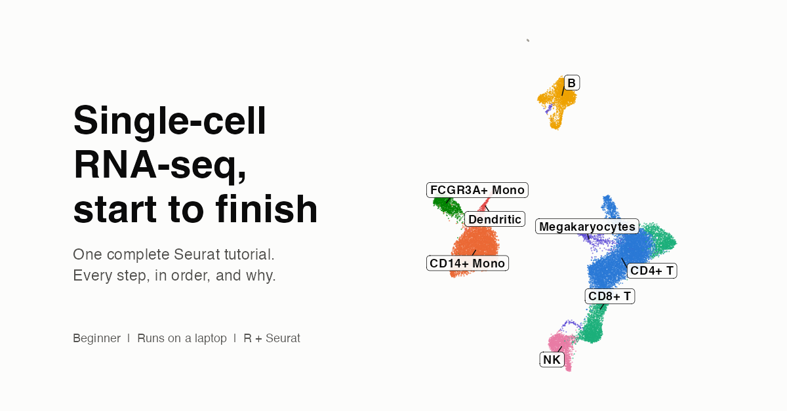

# Single-cell RNA-seq, start to finish

One tutorial that walks through a complete single-cell RNA-seq analysis in R, one step at a time, and explains why each step is there.

## Start here

**Just want to read it?**
[Open the finished tutorial in your browser](https://armilner.github.io/scrnaseq-tutorial/beginner/tutorial.html). All the code, plots and results are there, and you don't need to install anything.

**Want to run it yourself?**
Go to the [`beginner`](beginner) folder and follow the steps. It runs on a normal laptop, and you don't need any experience.

## What's in this repository

| Folder | What it is | Who it's for |
|---|---|---|
| [`beginner/`](beginner) | Complete analysis of blood cells from 8 people, untreated vs treated with interferon. Runs on a laptop. | Anyone new to single-cell |
| [`advanced/`](advanced) | Kidney single-nucleus data, starting from raw sequencing files on a computing cluster. **Work in progress.** | People with cluster access |

## License

Code is MIT licensed (see [LICENSE](LICENSE)). The data belongs to the original authors: Kang et al. 2018 (beginner) and Wilson et al. 2019, GSE131882 (advanced). Please cite them if you use it.
